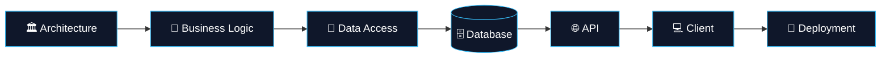

<!-- ===================== HEADER ===================== -->

 

---

## 👨‍💻 About Me

- 🎓 **Computer Engineer** & **Full Stack Developer** based in 🇹🇷 Türkiye
- 🏗️ Focused on **backend architecture**, **API design** and **database systems**
- ⚙️ Main stack: **ASP.NET Core · C# · React · TypeScript**
- 📱 Building **mobile sales systems** & **offline-first** apps with React Native
- 🧾 Hands-on with **POS devices**, **barcode systems** & **receipt printers**
- 🐧 Shipping to **Linux** environments with **Docker** & **Nginx**
- 💬 Ask me about **.NET, Clean Architecture, CQRS, React**

 

---

## 🛠️ Tech Stack

### ⚡ Backend

 

### 🎨 Frontend

### 📱 Mobile

### 🗄️ Database

 

### 🚀 Infrastructure

 

### 🧪 Testing

---

## 🧱 Architecture & Patterns

---

## 🧠 Engineering Mindset

> *I build systems that are not only functional, but also **maintainable** and **production-ready**.*

---

## 📊 GitHub Stats

 

 

---

## 🐍 Contribution Snake

<picture>
  <source media="(prefers-color-scheme: dark)" srcset="https://raw.githubusercontent.com/ismailtekinn/ismailtekinn/output/github-snake-dark.svg" />
  <source media="(prefers-color-scheme: light)" srcset="https://raw.githubusercontent.com/ismailtekinn/ismailtekinn/output/github-snake.svg" />
  
</picture>

---

### 🤝 Let's Connect

